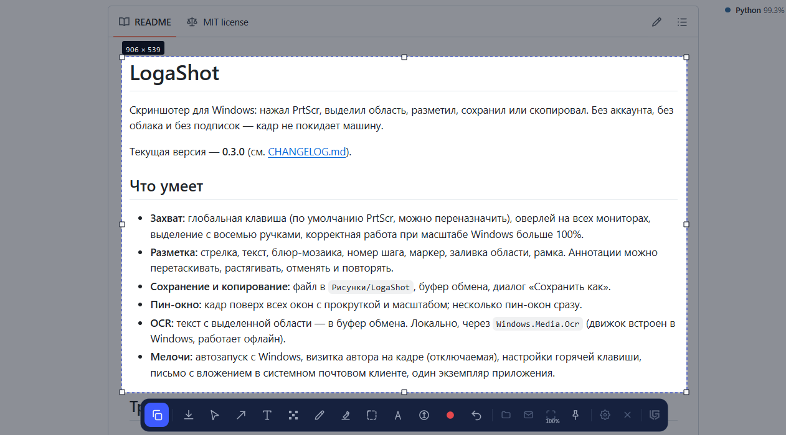
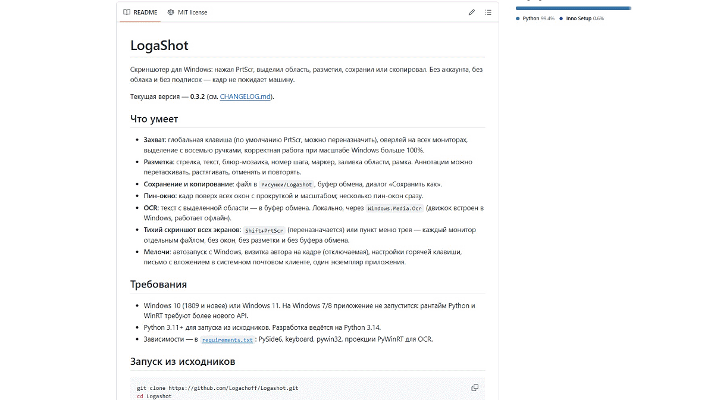
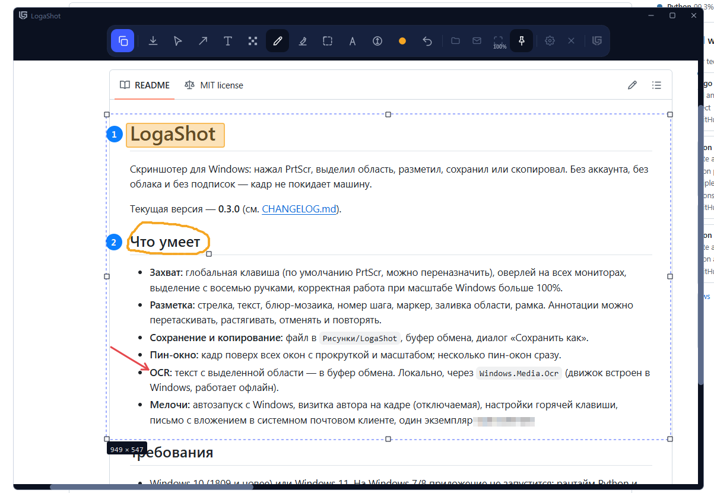

# LogaShot

**Скачать:** [Установщик (EXE)](https://github.com/Logachoff/Logashot/releases/download/v0.4.0/LogaShot_0.4.0_setup.exe) · [Portable (ZIP)](https://github.com/Logachoff/Logashot/releases/download/v0.4.0/LogaShot_0.4.0_portable.zip) · [Все релизы](https://github.com/Logachoff/Logashot/releases)

Скриншотер для Windows: нажал PrtScr, выделил область, разметил, сохранил или скопировал.
Без аккаунта, без облака и без подписок — кадр не покидает машину.

*A lightweight Windows screenshot tool — capture, annotate, pin, offline OCR. Fully local and private; the interface is in Russian.*

Текущая версия — **0.4.0** (см. [CHANGELOG.md](CHANGELOG.md)).





## Что умеет

- **Захват:** глобальная клавиша (по умолчанию PrtScr, можно переназначить), оверлей на всех
  мониторах, выделение с восемью ручками, корректная работа при масштабе Windows больше 100%.
- **Разметка:** стрелка, текст, блюр-мозаика, номер шага, маркер, заливка области, рамка.
  Аннотации можно перетаскивать, растягивать, отменять и повторять.
- **Сохранение и копирование:** файл в `Рисунки/LogaShot`, буфер обмена, диалог «Сохранить как».
- **Пин-окно:** кадр поверх всех окон с прокруткой и масштабом; несколько пин-окон сразу.
- **OCR:** текст с выделенной области — в буфер обмена. Локально, через `Windows.Media.Ocr`
  (движок встроен в Windows, работает офлайн).
- **Тихий скриншот всех экранов:** `Shift+PrtScr` (переназначается) или пункт меню трея —
  каждый монитор отдельным файлом, без окон, без разметки и без буфера обмена.
- **Проверка обновлений:** кнопка в «О программе» и пункт меню трея — по клику сверяет версию
  с последним релизом на GitHub; сама никуда не ходит, это единственное сетевое действие.
- **Мелочи:** автозапуск с Windows, визитка автора на кадре (отключаемая), настройки горячей клавиши,
  письмо с вложением в системном почтовом клиенте, один экземпляр приложения.



## Чем отличается

- **От ShareX:** не комбайн с сотней настроек — один жест от захвата до файла, настраивать
  почти нечего.
- **От Snipaste:** открытый код (MIT) и OCR из коробки — движок и русский язык уже есть
  в Windows, ничего доустанавливать не нужно.
- **От Lightshot:** кадр не улетает на чужой сервер — кнопки «поделиться ссылкой» нет
  сознательно; OCR и всё остальное работают офлайн.

## Требования

- Windows 10 (1809 и новее) или Windows 11. На Windows 7/8 приложение не запустится:
  рантайм Python и WinRT требуют более нового API.
- Python 3.11+ для запуска из исходников. Разработка ведётся на Python 3.14.
- Зависимости — в [`requirements.txt`](requirements.txt): PySide6, keyboard, pywin32,
  проекции PyWinRT для OCR.

## Запуск из исходников

```cmd
git clone https://github.com/Logachoff/Logashot.git
cd Logashot
py -m venv .venv
.venv\Scripts\activate
pip install -r requirements.txt
python src\main.py
```

Приложение стартует в трее, окна не показывает. Нажмите PrtScr (или своё сочетание) — появится
оверлей захвата.

## Клавиши

| Клавиша | Действие |
|---|---|
| PrtScr (настраивается) | Захват экрана |
| Shift+PrtScr (настраивается) | Тихий снимок всех экранов: файл на каждый монитор |
| Enter | Сохранить файл в `Рисунки/LogaShot` и скопировать в буфер |
| Ctrl+C | Скопировать в буфер |
| Ctrl+S | Сохранить как… |
| Ctrl+O | Открыть папку со снимками |
| Ctrl+M | Отправить письмом (системный почтовый клиент) |
| Ctrl+Z / Ctrl+Shift+Z | Отменить / повторить |
| Delete | Удалить выбранную аннотацию |
| V | Инструмент «Выбор» |
| 1 / 2 / 3 / 4 | Стрелка / текст / блюр / номер |
| 5 | Распознать текст (OCR) |
| 6 / 7 / 8 | Маркер / заливка области / рамка |
| Esc | Отменить захват |

## Где что лежит

| Что | Где |
|---|---|
| Снимки по Enter | `%USERPROFILE%\Рисунки\LogaShot` (`Pictures\LogaShot`) |
| Настройки установленной версии | `QSettings` (реестр, `HKCU\Software\Logachoff\LogaShot`) |
| Настройки portable-версии | `settings.ini` рядом с `LogaShot.exe` |
| Лог времени старта | `%TEMP%\LogaShot_startup.log` |

## Готовые сборки

К релизу приложены два артефакта одной версии:

| Файл | Что это |
|---|---|
| [`LogaShot_0.4.0_setup.exe`](https://github.com/Logachoff/Logashot/releases/download/v0.4.0/LogaShot_0.4.0_setup.exe) (~22 МБ) | Установщик: копирует программу в `Program Files`, создаёт ярлыки и деинсталляцию; настройки — в реестре |
| [`LogaShot_0.4.0_portable.zip`](https://github.com/Logachoff/Logashot/releases/download/v0.4.0/LogaShot_0.4.0_portable.zip) (~29 МБ) | Portable: распаковать в любую папку и запустить `LogaShot.exe`; настройки — в `settings.ini` рядом с ним |

Состав у них общий — один и тот же `LogaShot.exe` и папка `_internal`. Отличие только в том,
где живут настройки: установщик не кладёт маркер `portable` и `settings.ini`, поэтому
установленная копия не пытается писать в `Program Files`.
Контрольные суммы SHA-256 опубликованы в заметках к [релизу](https://github.com/Logachoff/Logashot/releases/latest).

### Антивирусы и SmartScreen

Сборка сделана через PyInstaller и не имеет цифровой подписи кода. Windows SmartScreen
и некоторые антивирусы могут показать предупреждение при первом запуске — это типичная
реакция на упакованные Python-приложения без подписи (ложное срабатывание). Исходный код
полностью открыт, сборку можно повторить самостоятельно: `python dev\build.py`.

## Сборка

Нужен установленный PyInstaller. Короткий путь:

```cmd
pip install -r requirements.txt pyinstaller
python dev\build.py
```

Результат — portable-сборка в `dist\LogaShot\`. Установщик собирается Inno Setup из
`scripts\setup.iss`. Подробности, включая обрезку лишних файлов и проверку сборки, —
в [docs/BUILD.md](docs/BUILD.md).

## Структура репозитория

```
src/        исходный код (PySide6, один модуль — один компонент)
tests/      автотесты (pytest)
dev/        сборка: PyInstaller-сборщик, генератор иконки, хук WinRT, версия для exe
scripts/    установщик Inno Setup, проверка лицензий зависимостей, сканер секретов
assets/     иконки приложения и трея
docs/       инструкция по сборке
```

## Проверки

```cmd
pip install pytest ruff
python -m pytest
ruff check src tests
python scripts\license_check.py
python scripts\secret_scan.py
```

Есть ещё ручной e2e-прогон собранной portable-версии (открывает exe, жмёт PrtScr, рисует
выделение, проверяет файл и `settings.ini`):

```cmd
python tests\e2e_portable_save.py
```

Его не запускает pytest: нужен собранный `dist\LogaShot\LogaShot.exe` и живой рабочий стол.

## Лицензия

MIT — см. [LICENSE](LICENSE). Автор: Сергей Логачев, <https://logachoff.ru>.
